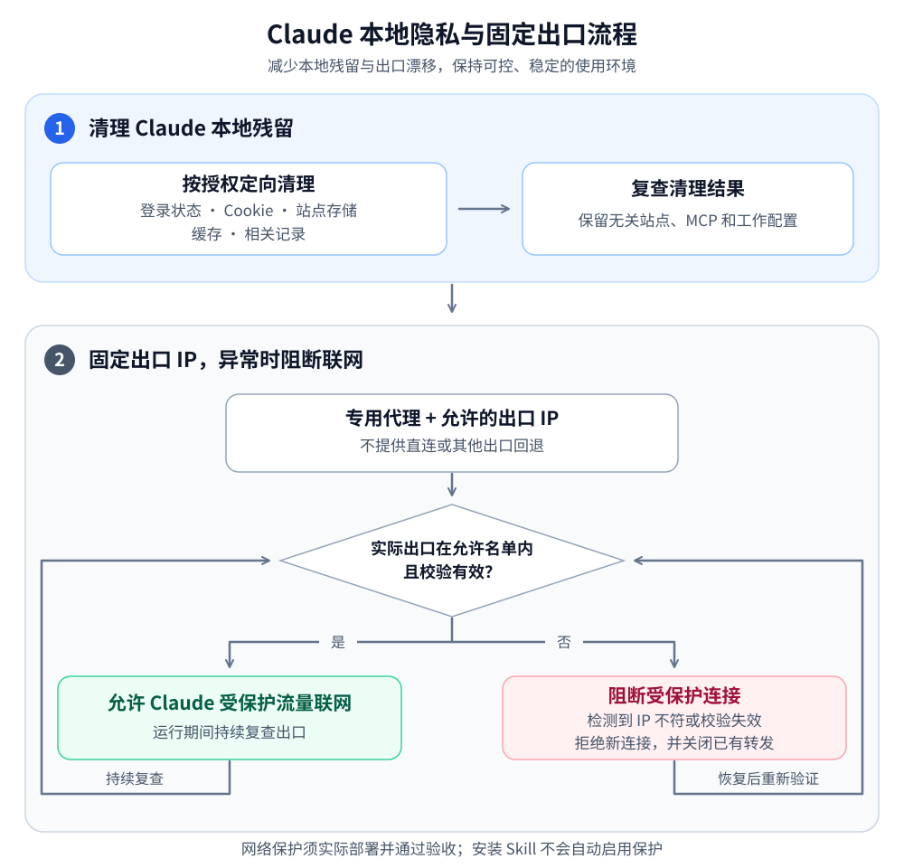

# Claude Windows Privacy Guard

面向 Codex 的 Windows Skill：定向清理 Claude 本地登录状态，检查专用代理启动条件，并指导实施指定出口与失败关闭保护。

**新增：[桌面工具与网页版隔离环境源码](backend/README.md)**。已公开可构建的实际后端源码、独立配置工具和离线测试，供审查与复用；尚未提供跨机器完整一键部署器。

A Codex skill for scoped Claude sign-in cleanup, read-only Windows startup checks, and fail-closed networking workflows.

## 项目背景

这个项目源于作者使用 Claude 时反复遇到账号被封或受限的经历。为了让使用环境更可控，我们把电脑上 Claude 的本地残留清理、允许访问的出口 IP 配置，以及出口异常时的连接阻断整理成了可复用的 Skill。

目标是减少本地状态残留、意外切换 IP 等环境因素可能带来的风控风险。具体包括定向处理桌面应用与浏览器的登录和站点记录，并指导部署固定出口保护：只有允许的 IP 且校验有效时才放行，检测到 IP 不符或校验失效时阻断受保护流量。

**完整图文使用流程： [Claude 本地清理与固定 IP 配置教程](https://agi-master.cloud/claude-network.html#guard-route)**。教程按确认使用情况、下载 Skill、盘点与清理、填写固定出口、部署保护、实测验收和安全启动的顺序展开，可以逐步照着操作。

## 作者

| 作者 | 参与内容 |
| --- | --- |
| [SWL-1229](https://github.com/SWL-1229) | 项目发起与维护、使用场景、需求和实际体验反馈 |
| GPT（通过 Codex 协作） | 方案梳理、脚本与文档编写、测试和排查辅助 |

## 两块核心流程

减少本地状态残留和意外更换出口，让 Claude 的使用环境更可控、更稳定。清理按需执行；下图的网络保护流程需要实际部署并通过验收，安装 Skill 本身不会自动启用保护。



[查看 Mermaid 流程图源文件](assets/workflow.mmd)

本地清理不重置硬件指纹；检测到出口异常后阻断的是 Claude/Anthropic 受保护流量。定期探测不代表逐包、零延迟检测。

## 解决什么问题

- **应用更新后突然无法连接。** 比对实际安装包与保护登记，发现旧规则仍指向旧版本的情况。
- **使用安全入口仍报 `ERR_PROXY_CONNECTION_FAILED`。** 检查是否已有 Claude 主进程占用单实例，并继续使用错误的代理参数。
- **需要退出本地登录，又要保留工作配置。** 清理独立桌面应用的认证存储和缓存，保留 MCP、普通配置与用户工作文件。
- **只清 Claude/Anthropic 浏览器数据。** 提供按域名、配置文件和存储类型处理的工作流，避免清空其他站点。

## 能力边界

| 内容 | 本仓库提供 |
| --- | --- |
| 桌面登录清理 | `desktop_cleanup.py`，默认只读，显式 `--apply` 才删除 |
| 运行时资料目录盘点 | `layout_inventory.py`，可在 Claude 运行时检查当前包与实际 `--user-data-dir`，不输出完整启动参数 |
| 启动前检查 | `launch_preflight.py`，只读检查包身份、主进程代理参数与端口监听 |
| 软件更新与旧进程防复发 | 分步骤排查、维护及验证流程 |
| 指定出口 / WFP / 浏览器代理保护 | `backend/` 提供网关、WFP、DNS、桌面及隔离浏览器源码；附构建与配置工具，完整部署事务仍需审查和现场验收 |
| 浏览器定向清理 | 操作方法与兼容性要点；不包含通用数据库修改器 |

**安装 Skill 本身不会创建防火墙规则、启动代理或开启断网保护。** 预检通过也不代表实际出口、WFP、浏览器策略已经有效。此工具不用于伪造设备指纹，也不承诺规避封号。

## 在自己的电脑复现

完整步骤见 [跨电脑复现流程](references/replication.md)，完成标准见 [逐项验收清单](references/acceptance.md)。执行顺序为：安装 Skill → 盘点真实安装与目录 → 选择清理范围 → 核对自有出口及已有网络后端 → 实施 → 验收 → 从安全入口使用。

每个人填写自己的出口 IP、代理协议/端口、入口节点和语言/时区要求。仓库不附带作者的私人参数。**本版可以直接运行清理与盘点；`backend/` 另提供实际后端的可构建源码快照，构建与配置文件准备不等于完成系统部署。** 公开副本默认空出口名单，未部署前保持拒绝，不生成伪造的保护登记。

安装后可以把下面这段交给 Codex：

```text
使用 $claude-windows-privacy-guard 按 references/replication.md 检查我的电脑。
先运行只读布局盘点，核对新版 Claude 的实际资料目录和已有保护工具。
我希望复现本地登录清理与固定出口保护；保留 MCP、Code/Cowork 工作文件及其他站点数据。
缺失的出口参数请向我确认；未提供的网络后端请列出缺项，不创建空壳安全快捷方式。
实际清理和部署应按我确认的范围执行，最后按验收清单分别报告通过及未验证项。
```

如果只需要清理登录，用后面的“清理桌面软件”请求即可，不必部署整套网络。

## 本版兼容改进

- 识别新版 `%LOCALAPPDATA%\Claude-Data\claude_pzs8sxrjxfjjc`，与旧 MSIX 目录一起盘点；该布局已在 4.4212 系列实际核对。未知/自定义目录标记待检查，不自动扩大删除范围。
- 定向移除已确认的 `config.json` OAuth 缓存、最近账户字段、本地设备登记与用量历史。只删 Cookie 可能仍保留登录状态。
- 新增 `--all-discovered`，明确选择同时清理本次发现的新旧桌面目录；执行前预检全部所选根，清理后复查正常配置和登录字段。
- 拒绝重解析目录及配置重定向；保留 MCP、普通配置和工作内容，不按 `token` 等关键词泛删文件。
- 补充链式代理入口切换、探测期限、刷新恢复、DevTools 依赖和 UDP/IPv6 的实测标准，区分“未验证”和“通过”。

## 安装

需要 Windows 10/11、PowerShell、Git，以及 Python 3.10 或更高版本。脚本只使用 Python 标准库；网络保护的实施还取决于已有组件和系统权限。启动预检目前面向 MSIX / Microsoft Store 安装；传统安装需要按工作流人工核对，不能把“未发现软件包”当作应用没有安装。

在 PowerShell 中克隆到 Codex 的技能目录：

```powershell
$skillsRoot = if ($env:CODEX_HOME) { Join-Path $env:CODEX_HOME 'skills' } else { Join-Path $env:USERPROFILE '.codex\skills' }
New-Item -ItemType Directory -Force -Path $skillsRoot | Out-Null
git clone https://github.com/SWL-1229/claude-windows-privacy-guard.git (Join-Path $skillsRoot 'claude-windows-privacy-guard')
```

已有同名目录时先检查现有改动，不要覆盖私人配置。安装后在新对话中使用：

已有 Git 克隆的用户可先运行 `git status --short` 检查本地改动，再在工作区无未保存修改时执行 `git pull --ff-only`。保留自己添加的本地资料，不要使用 `reset --hard` 或删除目录强行升级；更新后在新对话中使用新版 Skill。

```text
使用 $claude-windows-privacy-guard 检查 Claude 为什么无法连接。
先只读检查当前安装版本、专用代理监听和旧主进程，不要清理登录数据。
```

也可以明确请求：

```text
使用 $claude-windows-privacy-guard 清理 Claude 桌面软件的本地登录状态，保留 MCP 和工作文件。
```

## 本次增加的预防措施

1. **每次更新后重新发现安装包。** 不硬编码版本、EXE 数量或旧安装目录；维护保护时核对可执行文件的签名、路径和摘要。
2. **启动前检查现有主进程。** Electron 会复用已有实例；安全快捷方式的新代理参数可能无法替换旧实例。发现错误参数应先保存工作、完整退出，再从安全入口打开。
3. **代理参数逐项核对。** 专用代理、禁用本地绕过、禁用 QUIC 必须一致；重复或冲突参数不能视为通过。
4. **故障时保留限制。** 不通过删除 WFP 规则、切换共享自动节点或开放直连来“修好联网”。
5. **维护后验证成功与拒绝两面。** 除允许出口成功，还应验证错误出口、网关故障、共享端口和直连都会被拒绝，并确认普通网络可用。

详细步骤见 [启动与更新防复发](references/startup-prevention.md) 和 [出口保护验收](references/exit-protection.md)。

## 直接运行只读检查

在仓库目录运行。以下 `17894` 是**示例专用端口**，请换成本机已经配置的受保护网关端口：

```powershell
python -X utf8 scripts/launch_preflight.py --gateway-port 17894
```

可选的 `--installed-marker` 接收本工具约定的本地登记文件。登记用于检查一致性，不会安装保护或验证 WFP；不要把其他程序的任意 JSON 报告直接当登记使用。格式与命令见脚本的 `--help` 和防复发文档。

| 预检结果 | 含义 |
| --- | --- |
| `preflight_checks_passed` | 本轮启动条件检查通过，退出码 0；仍未验证出口与网络强制限制 |
| `needs_review` | 例如未提供登记、应用未运行；信息不足，退出码 2 |
| `blocked` | 例如版本不符、参数错误、监听缺失或查询失败；退出码 2，先排查原因 |

脚本在所有结果中都保留 `protection_verified: false`。不要为了获得退出码 0 而临时改登记或启动未受保护的应用。

桌面资料盘点：

```powershell
python -X utf8 scripts/layout_inventory.py
```

这个布局盘点可在应用运行时执行，只读检查当前包及进程暴露的资料路径；`review_needed` 表示需要人工核对。它不会读取 Cookie/OAuth 值，不会清理数据。完整退出 Claude 后，再运行存储盘点：

```powershell
python -X utf8 scripts/desktop_cleanup.py
```

先保存工作并正常退出 Claude，再盘点。清理命令的 `--root` 必须来自本次发现结果，`--report` 必须是应用目录之外的一个新文件：

```powershell
python -X utf8 scripts/desktop_cleanup.py --root '<本次发现的绝对数据目录>' --apply --report '<新的报告绝对路径.json>'
```

尖括号内容是占位说明，不能直接执行。清理会删除桌面应用的网站缓存、离线状态和未同步草稿；不删除云端聊天，不自动撤销服务端会话，不清独立 Claude Code CLI。

如果已确认全部已发现桌面目录均在清理授权内，可避免漏掉新旧并存的目录：

```powershell
$cleanupReport = Join-Path $env:TEMP ("claude-cleanup-" + [guid]::NewGuid().ToString('N') + '.json')
python -X utf8 scripts/desktop_cleanup.py --all-discovered --apply --report $cleanupReport
python -X utf8 scripts/desktop_cleanup.py
```

清理不能撤销，也不会备份认证值。报告中应看到每个已选根 `cookies_after: 0`、`remaining_selected_entries: []`、`login_ui_keys_remaining: []`、`preserved_files_verified: true` 和 `normal_config_verified: true`。最后再盘点一次；如需要通过欢迎页确认，应在当前网络保护已验收后打开，不能替用户登录。

## DevTools 是什么，需要一直开着吗？

DevTools 是 Claude 所用 Electron/Chromium 的内置开发者工具，不是本项目制作的。项目作者编写的是调用与验证它的启动、监控流程。相关接口见 [Electron 官方文档](https://www.electronjs.org/docs/latest/api/web-contents#contentsopendevtoolsoptions)。

是否需要附着、是否可最小化取决于实际部署的控制器。本机曾验证的方案依赖附着窗口，不能把这个结果当成所有设备的通用行为。主进程 Node Inspector 是另一种临时诊断接口，使用后应关闭，不能开放给局域网。公开 Skill 不会为其他人自动安装这套控制器；可审查并构建 [backend 源码](backend/README.md)，再按自己的机器部署验收。

日常使用从已验收的安全入口打开，不必每次清理登录；更新 Claude 后重新核对包和规则。运行中临时测不到出口不等于 IP 已变，按有效期执行暂停、复验与恢复；不要直接关闭保护，也不要宣称逐包零延迟。

## 验证与开发

```powershell
python -X utf8 -m unittest discover -s tests -v
python -X utf8 scripts/launch_preflight.py --help
python -X utf8 scripts/desktop_cleanup.py --help
python -X utf8 scripts/layout_inventory.py --help
```

测试使用临时目录和模拟进程信息，不清理真实应用资料，不修改真实网络规则。Windows CI 会运行同一套测试。测试证明辅助脚本的行为，不代替每台电脑的实际联网验收。

## 隐私与贡献

本仓库不包含真实出口地址、代理密码、账户、登录 Cookie、运行配置、私人机器报告或用户截图。提交问题时只提供脱敏后的错误类型、系统/应用版本和检查结论；不要上传 Cookie、令牌、完整进程命令行或代理订阅。

欢迎通过 Issue 描述复现步骤，通过 Pull Request 改进版本兼容与测试。新清理逻辑应同时证明目标记录被删除、无关数据被保留；未知存储格式应保留并报告。

[MIT License](LICENSE)
