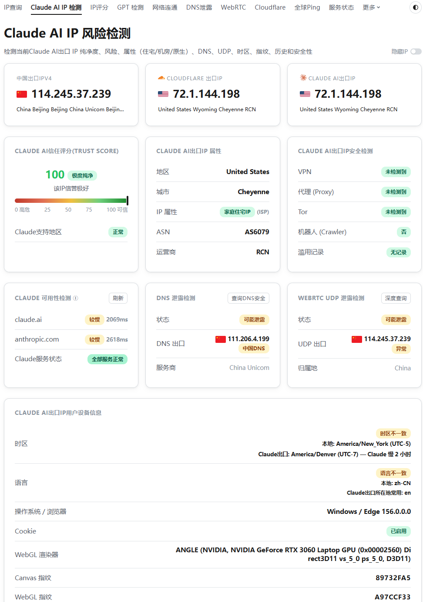
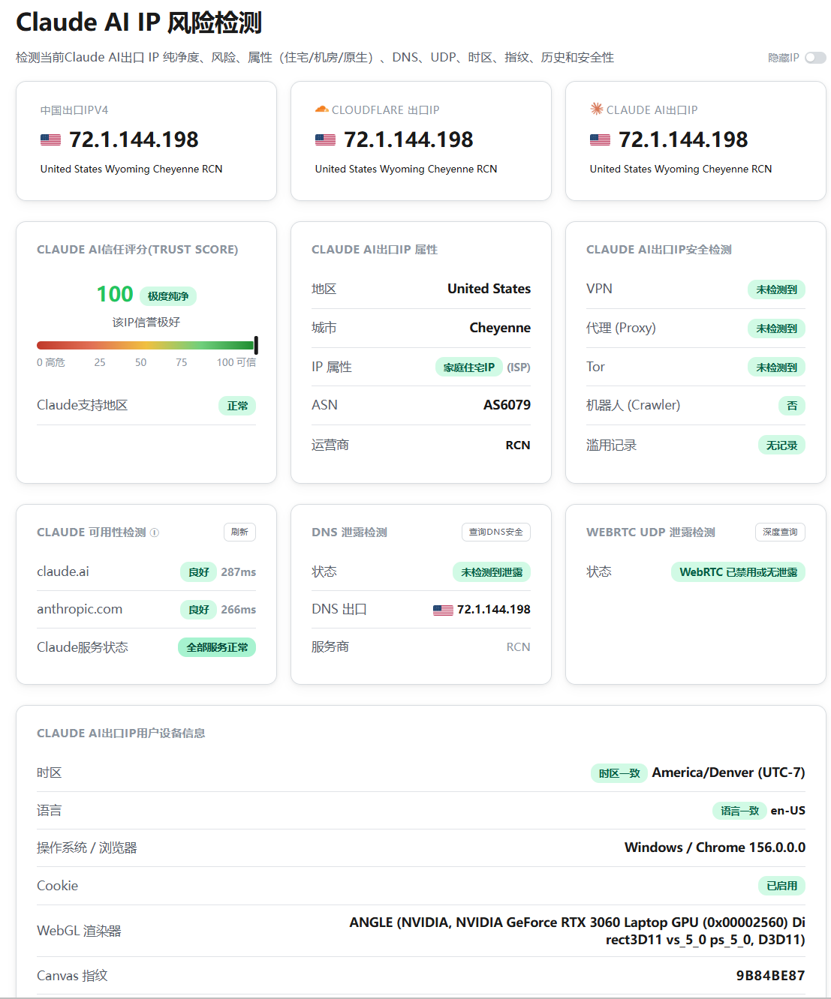
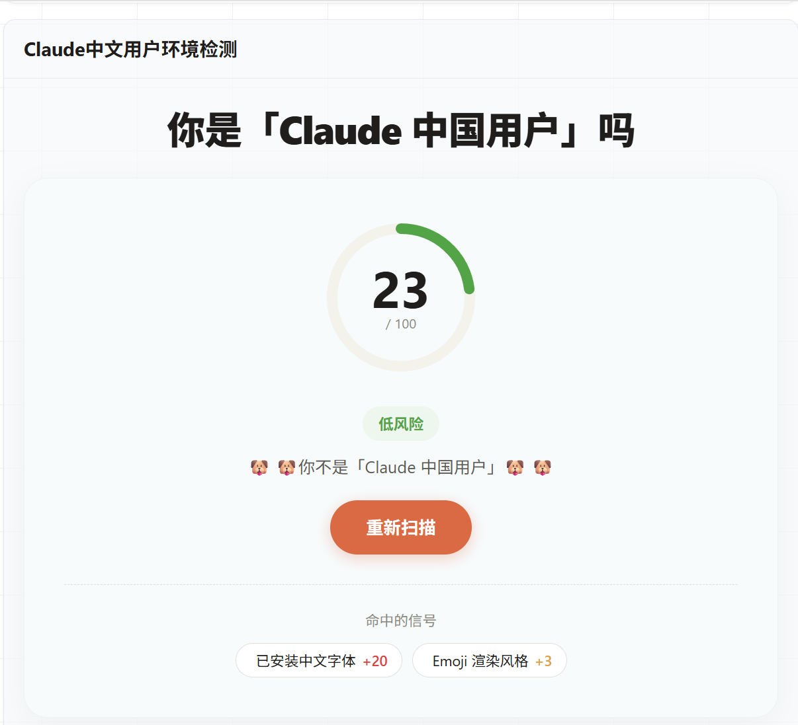
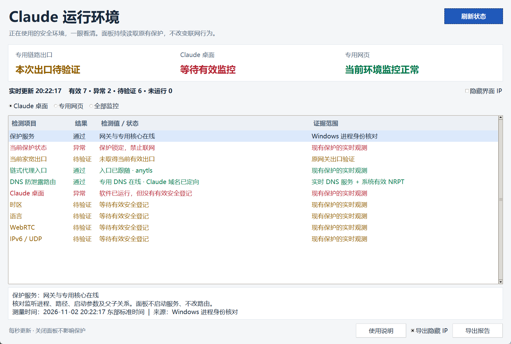
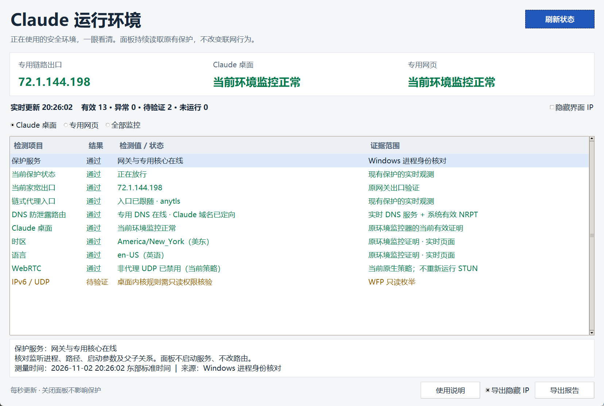
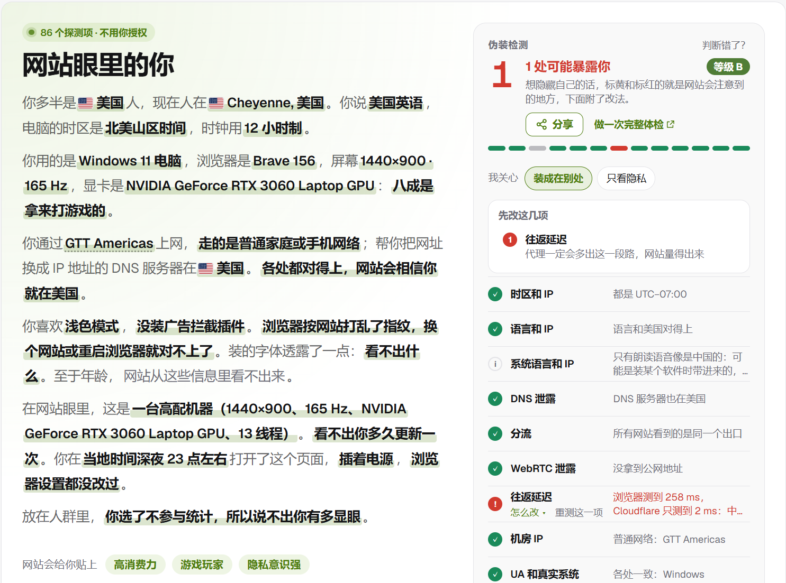
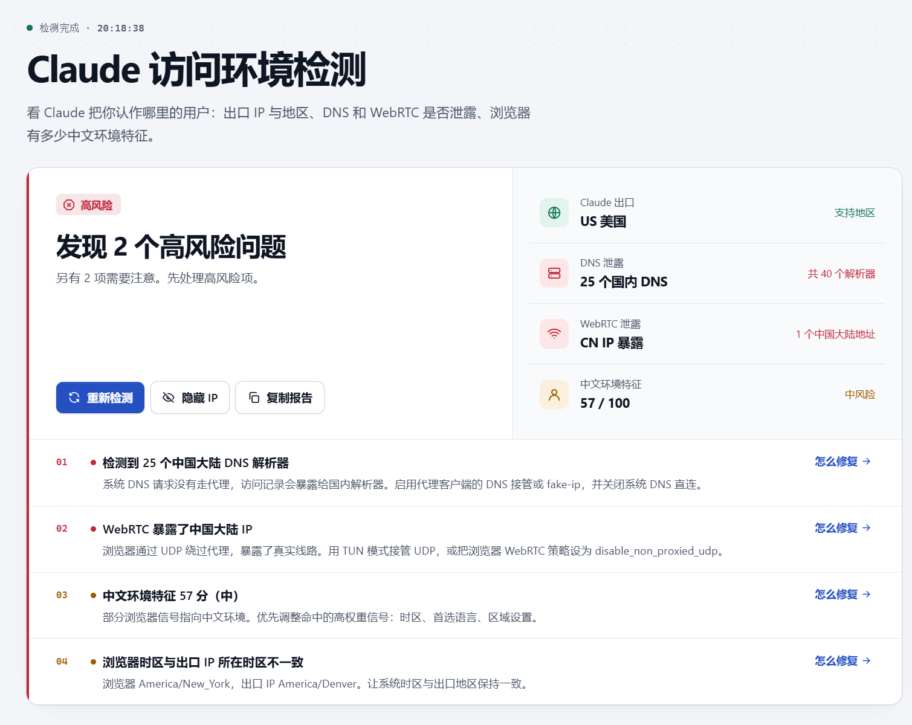

# 前后对比与当前实测

[返回项目首页](../README.md) · [独立浏览器工作流](../references/manual-browsers.md) · [实时面板](../detector/README.md)

以下是维护者提供并授权公开的原始截图，按问题分组展示，点击图片可看原图。不同图片来自不同阶段和浏览器；它们记录当次检测，不是同一时刻的全面验收，也不是 Anthropic 官方评分。

## 网络：从 DNS／UDP 泄露到出口一致

<table>
<tr><th width="50%">修改前</th><th width="50%">修改后 · 最新完整结果</th></tr>
<tr>
<td valign="top"></td>
<td valign="top"></td>
</tr>
<tr><td>网页出口与 DNS、UDP 出口不同；页面报告 DNS／WebRTC 可能泄露，语言和时区不一致。</td><td>三处 HTTP 出口和 DNS 出口一致；页面报告 DNS 未检测到泄露、WebRTC 已禁用或无泄露，时区为 America/Denver，语言为 en-US。</td></tr>
</table>

右图使用最后补发、DNS 已加载完成的版本。时区不一致的旧“修改后”图和 DNS 尚在加载的过渡图已弃用。截图中的 IP 为获授权展示的实例，复现时填写自己的允许出口，源码不内置这些地址。

## 语言与区域：检测分值 57 → 23

<table>
<tr><th width="50%">修改前 · 57 / 100</th><th width="50%">修改后 · 23 / 100</th></tr>
<tr>
<td valign="top"></td>
<td valign="top"></td>
</tr>
</table>

这是该站自己的启发式分值，不能判定国籍或等同于 Claude 的风控规则。右图仍列出中文字体与 Emoji 渲染特征；本项目没有删除系统中文字体。

## 面板：锁定与正常监控分别怎样显示

<table>
<tr><th width="50%">保护锁定／缺少有效登记</th><th width="50%">环境监控正常</th></tr>
<tr>
<td valign="top"></td>
<td valign="top"></td>
</tr>
</table>

这组是**历史界面状态示例**，其中的美东时区不是当前丹佛设置。右图保留了两个“待验证”：普通权限无法读取桌面 WFP 内核条件时，面板应显示待核验，不能因为其他项通过就变绿。新版增加管理员只读核验；需要本机当前版本对应的读取器和真实授权，不修改规则。

## 当前 Brave：原生隐私功能与手动使用

当前独立 Brave 入口使用正常的手动浏览器进程和 Brave 自带的指纹保护；没有连接 WebDriver／CDP，也不注入隐藏自动化的脚本。该站这次展示 B 级、1 项提示：**往返延迟仍可被观察到**。图片中显卡型号等设备信息仍可见，不能据此声称完全无法追踪。

Brave 对部分可指纹化数据采用原生随机化，目标是减少关联追踪，而不是让所有信息消失。[Brave 官方机制说明](https://brave.com/privacy-updates/3-fingerprint-randomization/)。

## 怎样复测

1. 手动连好自己的入口与住宅出口，再从已验收的安全入口打开。不要只看节点延迟绿字。
2. 在**同一个受保护窗口**检查 HTTP 出口、DNS 与 WebRTC；分别记录公网候选、私网候选和未测项。
3. 复查 `America/Denver`、英语以及刷新／新标签／浏览器重启；夏令时以地区规则为准，不永久固定 UTC−7。
4. 面板只读观察原保护；实时策略检查不代替数据包实测。桌面应用、Edge 和 Brave 的结论分别记录。

展开查看修改前的汇总报告

图片均未经改图；校验摘要见 [截图清单](../assets/screenshots/manifest.json)。除这组获授权的截图外，不发布运行配置、登录资料、原始机器报告或代理凭据。
